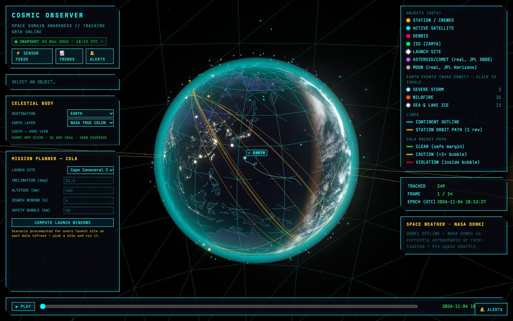
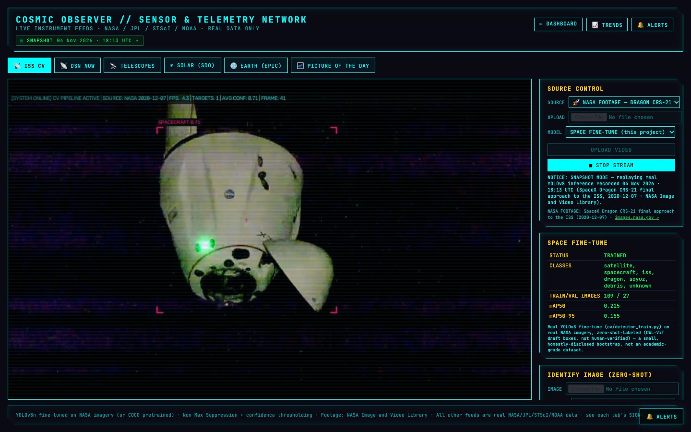
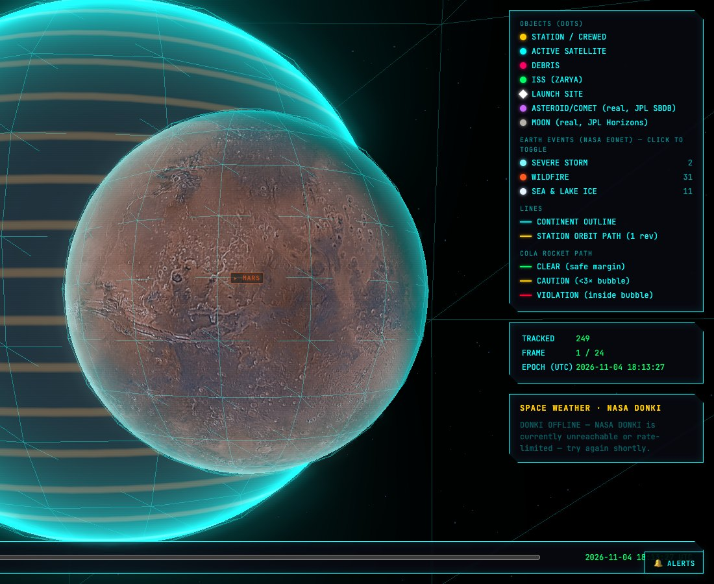

# Cosmic Observer

[](https://github.com/tunatyurkoglu13/cosmic-observer-new/actions/workflows/ci.yml)
[](https://github.com/tunatyurkoglu13/cosmic-observer-new/actions/workflows/pages.yml)

A space situational awareness platform: it tracks satellites and debris from
live orbital data, screens for close approaches, plans collision-free launch
windows, follows near-Earth-object risk and space weather, and runs computer
vision on real spacecraft footage — all on real data from NASA, JPL, NOAA and
CelesTrak, on a globe wearing the latest real satellite imagery of Earth.

**Live demo → [tunatyurkoglu13.github.io/cosmic-observer-new](https://tunatyurkoglu13.github.io/cosmic-observer-new/)**



## What it does

| Area | Details |
|---|---|
| **Living globe** | Earth textured with the latest *complete* Suomi NPP VIIRS true-colour mosaic from NASA GIBS (picked by measuring each day's coverage), swath gaps filled from Blue Marble, VIIRS city lights on the night side, lit by the real subsolar point for every frame |
| **Reference frames** | JPL Horizons ecliptic vectors rotated into an equatorial scene frame; everything Earth-fixed turns with Greenwich sidereal time, so the rendered Sun and the lit hemisphere agree (verified to ~0.4°) |
| **Orbit propagation** | TLE ingestion from CelesTrak with resilient caching, SGP4 propagation, a numerical propagator with J2/drag, Kepler solver, orbit determination |
| **Conjunction screening** | Close-approach search across the catalog, collision probability (analytic Pc and Monte Carlo), keep-out zones, debris density maps |
| **Launch planning (COLA)** | Launch-window search per site with ascent-trajectory screening against a moving safety bubble; flags unreachable inclinations and plane-change requirements |
| **Earth events** | Open NASA EONET events — wildfires, cyclones (with their full tracks), volcanoes, sea ice — on the globe, toggleable per category |
| **Space weather** | NASA DONKI solar flares, CMEs (with WSA-ENLIL Earth-arrival predictions) and geomagnetic storms, feeding the alert layer; NOAA Kp/F10.7 history |
| **Near-Earth objects** | JPL Sentry risk list, CNEOS close approaches, SBDB orbital elements propagated for curated asteroids and comets |
| **Computer vision** | A YOLOv8 fine-tune on NASA imagery run on real docking footage streamed from the NASA Image and Video Library (range requests, never downloaded), OWL-ViT zero-shot detection, an ISS-camera anomaly autoencoder, streak detection on FITS frames with WCS sky coordinates |
| **Planetary surfaces** | Moon (LRO WAC) and Mars (Viking MDIM 2.1) mosaics from NASA Solar System Treks, stitched client-side and lit by each body's real Sun direction |
| **Sensor feeds** | Deep Space Network status, latest Hubble/JWST observations (MAST), SDO solar imagery, DSCOVR EPIC Earth images, NASA Astronomy Picture of the Day |
| **Alerting** | Background scans persist deduplicated alerts and push them over WebSockets, with optional webhook delivery |

| | |
|---|---|
|  |  |

## Architecture

```
 CelesTrak · NASA · JPL · NOAA · MAST            (resilient fetch + on-disk cache)
                    │
   core/ orbital mechanics · stm/ conjunctions & COLA · data/ feed clients
   cv/ detection & anomaly models · reports/ risk & launch analysis
                    │
         app.py — FastAPI: REST + WebSockets + background scan loops
                    │
   static/ — Three.js dashboard, sensor feeds, trends, alerts (no build step)
```

### How the live demo is hosted

The public demo is a **static site on GitHub Pages** — there is no server to
attack, scale, or pay for. A scheduled GitHub Actions job
([`pages.yml`](.github/workflows/pages.yml)) runs the real backend headless
every three hours and captures its responses:

1. [`scripts/build_static_site.py`](scripts/build_static_site.py) starts the
   FastAPI app in-process (no network port), runs one pass of its metric
   sampling and alert scans, and requests every read-only endpoint the
   frontend uses — including a launch-window scan for every launch site and
   a short recording of real YOLOv8 inference.
2. Responses are written as JSON next to the frontend. A small adapter,
   [`pages/static-adapter.js`](pages/static-adapter.js), answers the
   frontend's `/api/*` requests and WebSockets from those files, so the
   dashboard code is identical to what runs against the live server.
3. Metric and alert history are carried between builds with the Actions
   cache, so the trends page accumulates real history over time; if an
   upstream API is down during a build, the previous response is reused.

Interactive inference (video upload, zero-shot image identification) needs
the live backend and is disabled in the demo.

## Running locally

Requires Docker, or Python 3.14.

```bash
cp .env.example .env        # optional: add your own NASA_API_KEY
docker compose up --build   # → http://localhost:8000
```

Without Docker:

```bash
python -m venv .venv && source .venv/bin/activate
pip install -r requirements.txt --extra-index-url https://download.pytorch.org/whl/cpu
uvicorn app:app --reload
```

Build the static site yourself with `python scripts/build_static_site.py`
(output in `_site/`).

## Tests

```bash
pytest -m "not network and not slow"   # offline suite, runs in CI on every push
pytest -m network                      # against the real external APIs
```

## Security

- **Public demo mode.** `PUBLIC_DEMO=1` (the Docker image's default) makes
  the app read-only: shared state such as video uploads and alert
  acknowledgement is disabled.
- **Input bounds.** Uploads are size-capped and stored under server-chosen
  names; every expensive parameter (scan windows, frame counts, stream rates,
  concurrent CV streams) has an upper limit.
- **Headers and CSP.** The server sets `nosniff`, a referrer policy and
  anti-framing headers; the static site ships a Content-Security-Policy that
  allows inline scripts only by hash.
- **Secrets.** API keys come from the environment and are never committed.
  The NASA key travels in the `X-Api-Key` header, never in a URL, so it
  can't leak through logs or error messages — and the Pages build refuses to
  publish if a secret's value appears in any output file.
- **Untrusted feed text.** Event titles and notes from external APIs are
  HTML-escaped before rendering, and only http(s) links are ever emitted.
- **Pinned dependencies.** Python packages and CDN scripts are pinned to
  exact versions.

## Project layout

```
app.py              FastAPI app: REST, WebSockets, background loops
core/               orbital mechanics, propagation, collision probability, stores
stm/                conjunction screening, COLA, keep-out zones, debris maps
data/               clients for CelesTrak, NASA (GIBS, Treks, EONET, DONKI, APOD), JPL, NOAA, MAST, DSN
cv/                 detection, tracking, anomaly model, NASA footage source, FITS ingest, HUD
models/             trained checkpoints the app serves (space fine-tune, anomaly autoencoder)
reports/            risk, statistics and launch-analysis reports
static/             frontend (dashboard, sensor feeds, trends, alerts)
pages/              GitHub Pages-only adapter, styles and 404 page
scripts/            static-site build, snapshot and seed-data tools
tests/              pytest suite
```

## Data sources

[CelesTrak](https://celestrak.org) (TLEs) ·
[NASA/JPL Horizons, SBDB, Sentry, CNEOS](https://ssd.jpl.nasa.gov) ·
[NASA GIBS](https://www.earthdata.nasa.gov/engage/open-data-services-software/earthdata-developer-portal/gibs-api) ·
[NASA Solar System Treks](https://trek.nasa.gov) ·
[NASA EONET](https://eonet.gsfc.nasa.gov) ·
[NASA DONKI](https://kauai.ccmc.gsfc.nasa.gov/DONKI/) ·
[NASA Image and Video Library](https://images.nasa.gov) ·
[NASA APOD](https://apod.nasa.gov) ·
[NOAA SWPC](https://www.swpc.noaa.gov) ·
[NASA DSN Now](https://eyes.nasa.gov/dsn/) ·
[MAST](https://archive.stsci.edu) ·
[SDO](https://sdo.gsfc.nasa.gov) ·
[DSCOVR EPIC](https://epic.gsfc.nasa.gov)
